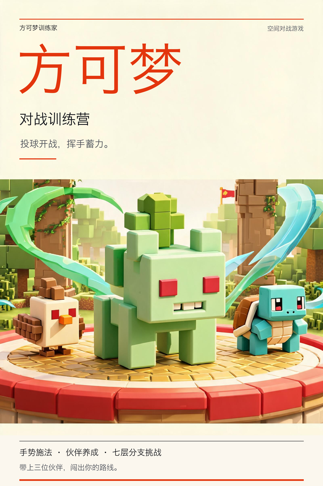

# Fangkemeng Trainer

[简体中文](README.zh-CN.md) | English



**Fangkemeng Trainer** is a mixed-reality companion battle game for PICO. Recruit and train voxel companions at camp, choose a branching adventure route, throw a ball in physical space to begin a battle, and combine turn-based commands with gesture charging.

## Gameplay

1. Recruit companions, train them up to level 20, and prepare your party and move loadouts at camp.
2. Start a seven-layer run. Follow branching and merging routes through regular and elite encounters, ending with a boss.
3. Enter the spatial battlefield and throw a ball to summon your party. Hand-tracked throwing and a panel button are both available.
4. Use the battle panel in front of your head to select moves, switch companions, and use items. Move your right hand to charge attacks.
5. Choose relic or recovery rewards after battles and purchase supplies at the intermediate supply stop. Health and relics persist across encounters; a party wipe ends the run.
6. Bring remaining coins back to camp after settlement and continue recruiting and training. Progress is saved locally on the device.

A cat companion also follows the player and responds to gaze and touch.

## Development and Technology

The project was developed through Vibe Coding using TRAE with GPT 5.6 SOL and GPT 6.1 SOL.

Development used pico-cli to list devices, install and launch APKs, capture Spatial screenshots, and read runtime logs. Development references include the [PICO developer resources](https://developer-cn.picoxr.com/resources/).

| Area | Technology |
| --- | --- |
| Application | Android, Kotlin 2.0.21 |
| Spatial runtime | PICO Spatial SDK 6.2.8 |
| UI | PICO SpatialUI, Jetpack Compose |
| 3D scenes | Geometric primitive modeling, voxel style, PBR materials |
| Input | Head and hand tracking, spatial interaction |
| Testing | JUnit |
| Development tools | pico-cli |
| Build | Gradle 8.13, Android Gradle Plugin 8.13.2 |

Camp, party preparation, and route selection appear in a window, while battles take place in a Mixed Stage.

## Models and Artwork

The 12 companions, trainers, and arenas are built from geometric primitives such as boxes and spheres. Colors, materials, and moving parts give them distinct appearances and animations. Arena designs cover nine themes: meadow, arena, forest, volcanic, ruins, storm, crystal, sky, and throne.

The game icon and poster are in [`output/artwork`](output/artwork/).

## Build and Run

Install JDK 17 and Android SDK Platform 35, and set `ANDROID_HOME` to the SDK directory. Build Release from the repository root:

```bash
./gradlew assembleRelease
```

The output is `app/build/outputs/apk/release/app-release-unsigned.apk`. Submit the GitHub repository URL and the full 40-character commit ID from `git rev-parse HEAD` to PICO Vibe Lab; the platform signs the APK.

Run local tests and build Debug:

```bash
./gradlew :app:testDebugUnitTest :app:assembleDebug --console=plain
```

Install and set up pico-cli, then install and launch the Debug APK:

```bash
npm install -g @picoxr/pico-cli && pico-cli setup
pico-cli app install app/build/outputs/apk/debug/app-debug.apk
pico-cli app launch com.example.fangkemeng --activity .app.LaunchActivity
```

## Layout

```text
app/src/main/kotlin/com/example/fangkemeng/
  app/       Containers, camp, party preparation, and route UI
  model/     Battle rules, growth, routes, relics, and saves
  input/     Gesture recognition and charging
  battle/    Procedural models, spatial battles, animation, and effects
  ui/        SpatialUI components and theme
app/src/main/res/   Android resources and launcher icons
app/src/test/       JVM unit tests
output/artwork/    Game icon and poster
```

## License

This project is licensed under the [MIT License](LICENSE).
