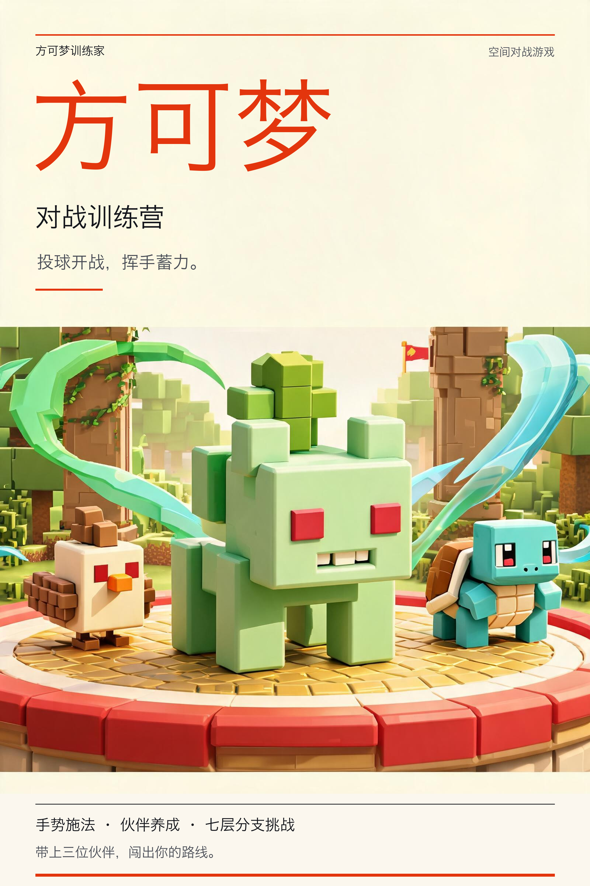

# 方可梦训练家

简体中文 | [English](README.md)



**方可梦训练家**是一款面向 PICO 的混合现实伙伴对战游戏。玩家在营地招募和训练方块伙伴，沿分支路线挑战训练师，在真实空间中投球开战，通过回合指令与手势蓄力完成冒险。

## 玩法

1. 在营地招募伙伴、训练等级、配置队伍与招式。伙伴等级上限为 20。
2. 开始一局七层冒险，在分支与汇合路线中选择普通战斗、精英战斗，最后挑战首领。
3. 进入空间战场，投出精灵球召唤队伍。支持手部追踪投球，也提供面板按钮入口。
4. 通过头部前方的战斗面板选择招式、换人和道具；挥动右手积累招式蓄力。
5. 战后选择遗物或恢复奖励，在途中补给点购买资源。生命与遗物跨战保留，全队倒下则本局结束。
6. 结算后将剩余金币带回营地，继续招募与训练。进度保存在设备本地。

场景中还有一只随玩家移动的猫伙伴，支持注视、跟随和触摸反馈。

## 开发方式与技术栈

项目使用 TRAE，配合 GPT 5.6 SOL 和 GPT 6.1 SOL，通过 Vibe Coding 完成开发。

开发时使用 pico-cli 查询设备、安装和启动 APK、采集 Spatial 截图以及读取运行日志。相关开发资料参考 [PICO 开发者资源](https://developer-cn.picoxr.com/resources/)。

| 领域 | 技术 |
| --- | --- |
| 应用 | Android、Kotlin 2.0.21 |
| 空间运行时 | PICO Spatial SDK 6.2.8 |
| 界面 | PICO SpatialUI、Jetpack Compose |
| 3D 场景 | 基础几何体组合建模、体素风格、PBR 材质 |
| 输入 | 头部与手部追踪、空间交互 |
| 测试 | JUnit |
| 开发工具 | pico-cli |
| 构建 | Gradle 8.10.2、Android Gradle Plugin 8.8.2 |

营地、编队和路线显示在窗口中，战斗在 Mixed Stage 中展开。

## 模型与素材

游戏中的 12 种伙伴、训练师和擂台由长方体、球体等基础几何体组合生成，通过颜色、材质和部件运动表现不同的外形与动作。擂台包含草地、竞技场、森林、熔岩、遗迹、风暴、晶簇、云端和王座九种主题设计。

游戏图标和海报位于 [`output/artwork`](output/artwork/)。

## 构建与运行

安装并初始化 pico-cli：

```bash
npm install -g @picoxr/pico-cli && pico-cli setup
```

构建 APK：

```bash
./gradlew :app:testDebugUnitTest :app:assembleDebug --console=plain
```

使用 pico-cli 安装和启动：

```bash
pico-cli app install app/build/outputs/apk/debug/app-debug.apk
pico-cli app launch com.example.fangkemeng --activity .app.LaunchActivity
```

## 目录

```text
app/src/main/kotlin/com/example/fangkemeng/
  app/       容器入口、营地、编队与路线界面
  model/     回合规则、成长、路线、遗物与存档
  input/     手势识别与蓄力
  battle/    程序化模型、空间战斗、动画与技能效果
  ui/        SpatialUI 控件与主题
app/src/main/res/   Android 资源与启动图标
app/src/test/       JVM 单元测试
output/artwork/    游戏图标与海报
```

## 许可证

项目采用 [MIT 许可证](LICENSE)。
